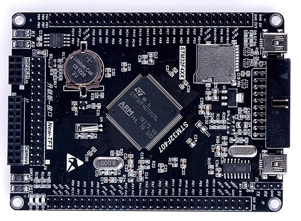

# PICO-Electronics 电气设计

本仓库是 [PICO-Humanoid](https://github.com/pico-humanoid/pico-humanoid.github.io "访问项目主入口") 负责电气设计部分的子项目，主要涵盖电源方案、电路板设计等内容。

## 电源方案

- 主电源
    - 电压：48V (13S)
    - 其他数据待调研

- 弱电源
    - 19V DC-DC
        - 供 Jetson Orin NX 使用
        - [参考商品](https://item.jd.com/10138079795809.html?pcdk=u330SRCgx35lDWlhAyD_OZFVwC-yGBpGtrJ5H8DzbxypaTGz2k9U0WP4V1iK2m8T.rQ4a.tlbT&spmTag=YTAyNDAuYjAwMjQ5My5jMDAwMDQwMjcuMyUyM3NrdV9jYXJkJTQwMTc5MTg4NTgwMDMzNiUyMzE4NDIwNjEwNiUyMzE3MzMwMDExMjE "访问“京东”")
    - 5V DC-DC
        - 供 MCU 及其他弱电设备使用
        - [参考商品](https://item.jd.com/10223872539848.html?extension_id=eyJhZCI6IjI2OCIsImNoIjoiMiIsInNrdSI6IjEwMjIzODcyNTM5ODQ0IiwidHMiOiIxNzkxODg1NTkwIiwidW5pcWlkIjoie1wiY2xpY2tfaWRcIjpcIjU1NjA5MmU5LWYzY2UtNGY4Mi1hZDExLTJhMzIxZTA3NWI5Y1wiLFwibWF0ZXJpYWxfaWRcIjpcIjc5OTk2NzQ2NTc4XCIsXCJwb3NfaWRcIjpcIjI2OFwiLFwic2lkXCI6XCIyNTA0YmY1Ni0zMmNmLTQzMjQtODk5NC1mZjNmOGFhMjg1YzNcIn0ifQ%3D%3D&jd_pop=556092e9-f3ce-4f82-ad11-2a321e075b9c&abt=0&pcdk=sZEKRLoJzNmrqGWR3qlhIMAUPQFZNMxRNPm0MqF3Z4Zqia7KWM5M5URTZtIT8HU6.rQ4a.tlbT "访问“京东”")
        

## PCB 设计

> 加入嘉立创 PICO-Humanoid 团队：
> https://u.lceda.cn/join?type=team&key=3ae4fa2f6dcc287a4c28ea388aabda9c&inviter=3521a3620bad4043a5a4a711afc9a91c&team_uuid=f433dbb9b1824e4bb703ed7ed252efce

### PCB-1：分电板

- **分电板作用：**
    - 将 48V 电池供电接口分为 12 路 xt30(2+2) 电机电源线
    - 提供弱电DC-DC模块的输入接口
    - 12路电机CAN的集成
- **接口建议：**
    - 48V 输入：XT60接口
    - 电机电源线：XT30(2+2)
    - 弱电输出：可灵活处理
    - CAN 接口（连接MCU主板）：采用 GH1.25 等防呆排线

### PCB-2：MCU主板

- **主板作用：**
    - 接受 5V 供电，为核心板供电
    - 为核心板提供统一的电机 CAN 接口
    - （可选）提供其他指示信息（如LED、蜂鸣器等）

- MCU 采用成品开发板
    - [参考商品](https://item.jd.com/10148987370623.html?spmTag=YTAyMTguYjAwMjQ1NS5jMDAwMDM5OTEucHJvZHVjdF9uYW1lJTQwMTc5MTg4NjI5MTkzMSUyMzE4NDIwNjEwNiUyMzcxNTczOTgwMQ)
    - 依据 MCU 排针布局设计主板排母

        