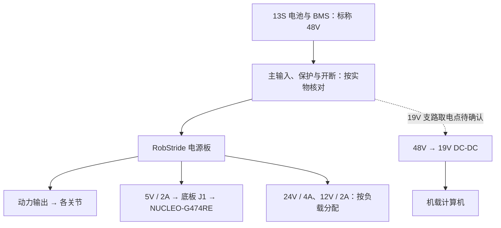
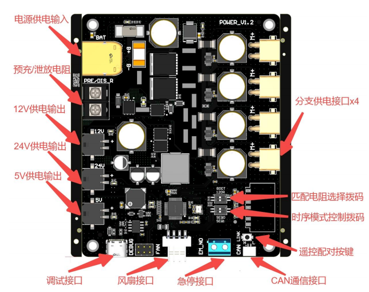

# 整机供电与线束方案

更新：2026-10-31。保留原有 RobStride 电源板、5V 控制支路和独立 19V 上位机支路；下文标明资料参数、当前方案与待实测内容。

## 1. 电源链路

虚线表示尚需确认的实际接线，不能据图认定急停一定切断或保留上位机供电。电机回流走动力回路，不能借底板的小信号地线承载电机电流。

## 2. 电源板

沿用原仓库选定的 [RobStride 电源板商品](https://item.taobao.com/item.htm?id=1025248375262)、[V1.5 使用说明](../datasheet/电源板使用说明V1.5_20260507.pdf)和[机械模型](https://github.com/pico-humanoid/pico-mechanism/blob/main/Board/POWER_PCB_V1.3_1105.step)。以下为资料参数，实物版本和环境条件另行核对。

| 项目 | 当前资料 |
| --- | --- |
| 输入连接器 | XT60 |
| 输入范围 | 20–65V；输入低于 30V 时 24V 输出关闭，见手册第 4 页 |
| 动力输出 | XT30，输出电机母线电源；不是把 48V 稳压成另一路固定 48V |
| 单支路载流 | 手册标称额定 20A、峰值 40A；不能按支路数量相加作为整机持续能力 |
| 辅助输出 | 24V/4A、12V/2A、5V/2A；按手册条件使用 |
| 电源板 CAN | 默认 1Mbit/s、经典 CAN、29 位扩展数据帧；实机设置仍需核对 |

电池、BMS、总线束、连接器、环境和散热共同限制整机能力。电源板的过流保护阈值不等于允许长期工作电流；不能用旧草案中的“80A 峰值”作为电池实测结论。

## 3. 底板及 MCU：直接使用已有 5V 输出

电源板 5V/2A → 控制电源线 → 底板 J1（1 脚 5V、2 脚 GND）→ 开发板选定的 5V 供电入口。底板的三颗 TJA1051T/3 使用 5V VCC，3.3V 逻辑电源由开发板提供，详见[主板方案](../board/主板方案.md)。

当前不另加一套 48V→5V 模块。2A 是电源板该输出的标称能力，底板、开发板和其他共用负载合计是否满足余量，需要列负载并测量启动、稳态及通信时电流。

首次接入前核对 Nucleo 板卡修订版、外部供电跳线和 USB/ST-LINK 接法，避免不经核对就并联多个 5V 电源。不能把 48V 接到 J1，也不能把 5V 直接送到 3V3 网络。

## 4. 机载计算机：保留独立 19V 支路

原方案为 48V→19V/5A [DC-DC 模块](https://item.jd.com/10138079795809.html)，配 [18AWG、5.5×2.5mm 电源线](https://item.jd.com/10177970571269.html)。19V/5A 是模块选型标称值，不表示上位机实际消耗 5A。确认模块输入上限覆盖电池满电及母线瞬态，并核对输出极性、插头、压降、启动能力和散热。

原首页写 Orin NX，原供电文档写“Jetson Orin Nano Super 4”，两者表述不一致；本轮统一称机载计算机，具体模块、载板及输入要求按铭牌确认，不擅自改为另一型号。

原方案提出从肩关节末端的 XT30(2+2) 线引出 19V 模块输入。该位置尚缺最终接线与负载记录，保留为布局候选：需与独立取电比较路径长度、载流、压降、拉扯和急停后的供电行为，再确定。不能因物理位置接近就视为电气上已经验收。

团队已分享 19V 上位机启动和主电源初测；尚未归档负载、电压、电流、时长与温升数据。

## 5. 动力与 CAN 分别规划

现用电源板的电机供电 XT30 **不集成电机 CAN**，不能直接当作 XT30(2+2) 通信集线板。需要单独规划 CAN 集线/转接和电机混合插头的逐针定义；GH 两针座只有 CANH/CANL，不能提供电机电源。

- 以主干串接、短分支为起点规划 CAN 线束；多个并联插座不代表可以任意拉成长星形。
- 每条独立 CAN 主干的两个物理末端各设一个 120Ω 终端。电阻跨接 H 与 L，不能接到电源线上；电机、适配器、底板自带的终端均计入。
- 底板位于总线末端时投入该路 SW；位于中间时通常断开。与电源模块位置无关，依据 CAN 实际拓扑确定。
- GH 两针接口没有专用信号地；按收发器和设备要求确认信号参考地/共地路径及地电位差，不能默认依靠机架、屏蔽层或动力大电流回路解决。
- 总线端口、动力接口、分支方向均贴标签，记录插头插座视角和线序；线色不能代替逐针核对。

逐关节型号、设备 ID、分支长度及终端位置尚待装配确认，沿用固件[关节映射表](https://github.com/pico-humanoid/pico-firmware/blob/main/docs/collaboration/joint-map.csv)补充，避免维护两份冲突的设备 ID。

## 6. 保护、急停、时序与再生能量

| 项目 | 已有依据 | 本项目仍需落实 |
| --- | --- | --- |
| 电池保护 | 电池配 BMS | 铭牌/保护参数、线束与主保护的协调 |
| 电源板保护 | V1.5 手册列过欠压、过流、短路、过温与急停功能 | 实物版本、配置、作用支路及恢复过程 |
| 急停按钮 | 原采购方案为施耐德 XB2-BS545C；[模型](https://github.com/pico-humanoid/pico-mechanism/blob/main/Other/XB2-BS542C.sldprt)后缀不同 | 实际按钮与触点型号、逻辑、接入端子；不能默认小触点能直接开断整机直流动力电流 |
| 预充/泄放 | 手册第 4–5 页描述预充电阻及泄放功能 | 阻值功率、安装、热防护、实际配置和验证 |
| 再生能量 | 关节制动可能向母线回灌 | 满电、BMS 断开等情况下的母线电压与吸收路径，联合评审后测试 |

手册说明急停默认接常开状态、针对动力支路，解除后需重新上电恢复；这是设备资料描述，实际按钮接线、故障动作与恢复流程仍须确认。不能据此宣称全机所有电源均断开；手册还说明 5V 默认上电、动力上电受 MODE 与命令控制。首次联调记录 MODE 状态、各路实测时序和急停后的电源行为。

手册的默认泄放开启值为 64V，不能直接认定该默认配置适合 13S 电池及实际驱动器；其工作还依赖手册所列条件。实际阈值、外接电阻和恢复动作需按所有设备允许范围共同确定，不在缺少实物资料时给出运行参数。

线束裸露焊点、终端电阻、DC-DC 接头使用合适绝缘和应力释放。首次上电及验收顺序见[装配上电与联调](../docs/装配上电与联调.md)。

[电池方案](电池方案.md) · [待确认事项](../docs/待确认与协作事项.md) · [返回首页](../README.md)
