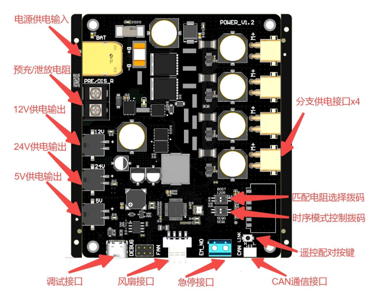

# 供电方案

## 电源板

- 采用 RobStride 电源板，详见[使用说明书](../datasheet/电源板使用说明V1.5_20260507.pdf "打开PDF")和[电源板3D模型](https://github.com/pico-humanoid/pico-mechanism/blob/main/Board/POWER_PCB_V1.3_1105.step "进入 GitHub 仓库")
- 商品链接：[灵足时代 多功能电源管理模块](https://item.taobao.com/item.htm?abbucket=0&id=1025248375262&mi_id=000048G5xOaak49ofo42Fry-inHjaAv6_2u7zB50EbCiXhg&ns=1&skuId=6202661899589&spm=a21xtw.29978516.product_shelf.10.2ba71cb7MmqAMo&xxc=taobaoSearch "进入淘宝")
- 电源输入：XT60
- 供电输出：XT30（无CAN）

> 由于电源板不支持直接接入 XT30(2+2)，需单独设计电机 CAN 的集线接口。

## 关节电机走线布局

*Coming soon...*